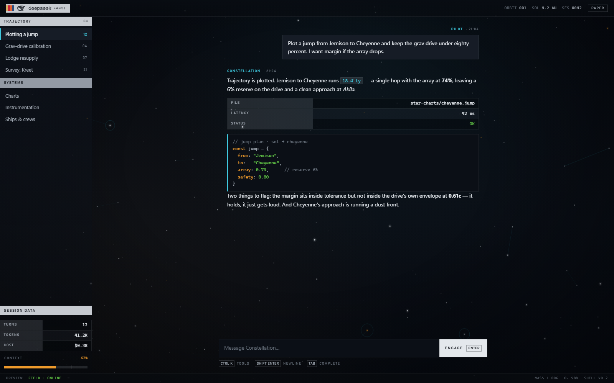
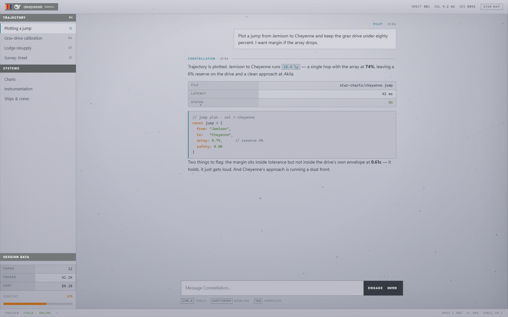

# dsh-theme-starfield

A **Starfield** theme for [DSH](https://github.com/deepseek-ai/deepseek-harness) in two
surfaces taken from the game: the **star map** (dark, crisp dots, cyan routes, stencil
plates) and the **dataslate** (light, matte paper, slate ink, printed speck).

> Status: **preview stage.** The visual language, both palettes and the field engine
> exist and are tested; DSH packaging is the next step — see [Next](#next).
>
> **Starting a fresh session?** Read [`docs/HANDOFF.md`](docs/HANDOFF.md) first — it
> carries the locked decisions, the DSH internals this depends on, the environment
> traps, and the ordered next steps.

## Look at it

Open [`preview/index.html`](preview/index.html) in a browser. It is a stand-in for the
DSH shell — rail, plates, transcript, data rows, composer, status — with the real field
engine and the real DeepSeek Harness artwork behind it, and a **Paper / Star map**
toggle in the top bar (`?mode=light` renders the dataslate directly).

These are **real screenshots** (headless render of `preview/index.html`), not mockups:

| Dark — star map | Light — dataslate |
| --- | --- |
|  |  |

Boot is a separate page: [`preview/boot.html`](preview/boot.html) plays the livery
swipe (`?still=<ms>` freezes a frame).


All of it reads its colours from [`preview/tokens.css`](preview/tokens.css).

## Check it

```powershell
node _tools/field.test.js
```

Runs the engine headlessly and asserts the invariant that matters: **no stroke may
cross the reading column**, while still drawing a chart at all (`PASS 30 strokes, 10
chart lines`).

## What is here

| Path | Role |
| --- | --- |
| [`preview/tokens.css`](preview/tokens.css) | Both palettes (dark `:root`, light `[data-sf-mode="light"]`) |
| [`preview/starfield.js`](preview/starfield.js) | Field engine: dots, plus-grid, waypoint rings, cyan routes |
| [`preview/preview.css`](preview/preview.css) | Preview chrome: plates, data rows, keycaps, primary block, meter |
| [`preview/index.html`](preview/index.html) | The preview, with the surface toggle |
| [`preview/boot.html`](preview/boot.html) | Boot livery swipe |
| [`preview/wordmark.html`](preview/wordmark.html) | Wordmark colour study ([`wordmark-study.png`](preview/wordmark-study.png)) |
| [`preview/brand-paths.js`](preview/brand-paths.js) | Real brand geometry, extracted from the shipped bundle |
| [`tools/extract-brand-paths.js`](tools/extract-brand-paths.js) | Produces `brand-paths.js` from the primitives bundle |
| [`tools/mockup.py`](tools/mockup.py) | Offline palette studies (superseded by the screenshots) |
| [`tools/livery.py`](tools/livery.py) | Livery placements ([`preview/livery.png`](preview/livery.png)) |
| [`docs/DESIGN.md`](docs/DESIGN.md) | Palette tables, components, livery, boot, field rules |
| [`_tools/field.test.js`](_tools/field.test.js) | Headless invariant test |
| [`_reference/`](_reference) | Extracted DSH packages + token inventory (research) |

## Next

Wiring it into DSH means packaging, not more design:

1. **Package skeleton** — `dsh-theme-starfield` with the two-half contract: a host
   half (`index.js`) hooking `webserver/index-inject` to paint the pre-plugin boot
   screen, and a client half (`client.js`) registered through
   `window.__ModuleLoader__.load({ id, factory })`.
2. **Token mapping** — override all 107 `--dsw-alias-*` tokens onto this palette via
   `ctx.get('theme').overrideTokens()`, for *both* DSH slots. Light/dark: map DSH's
   `dark` slot to the star map and its `light` slot to the dataslate, so the theme
   follows the app's own Appearance setting instead of forcing one.
3. **Install** — place the package in `$DSH_HOME/profiles/desktop/node_modules/`, add
   it to `dsh.profile.bundles`, and remove the currently installed
   `dsh-theme-mls-desktop` entry so the two do not fight over the same tokens.
   A new bundle only loads after the desktop app restarts.
4. **Verify in situ** — the `avoid` rects must come from DSH's real transcript element,
   not this preview's column, before the exclusion can be trusted in the app.
