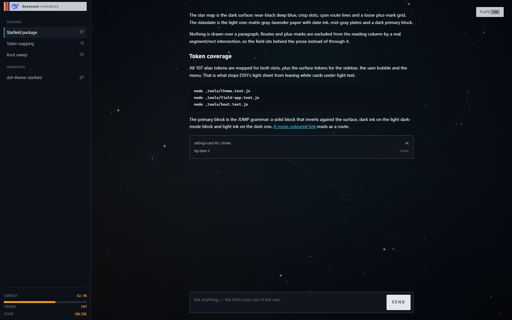
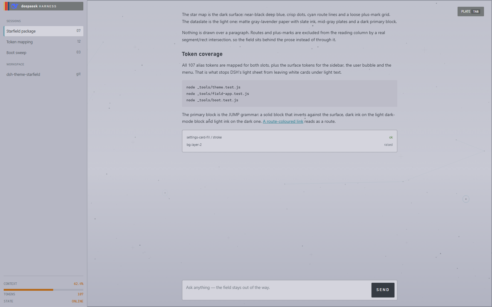

# dsh-theme-starfield

A **Starfield** theme for [DSH](https://github.com/deepseek-ai/deepseek-harness)
in two surfaces taken from the game: the **star map** (dark — crisp dots, cyan
routes, stencil plates) and the **dataslate** (light — matte paper, slate ink,
printed speck). The theme follows the app's own Appearance setting.

> **Status: packaged and offline-verified; not installed yet.** The bundle in
> [`package/`](package) is built from [`src/`](src) and passes its tests. The next
> step is installing it and restarting the desktop app — see
> [`docs/HANDOFF.md`](docs/HANDOFF.md) §8.
>
> **Starting a fresh session? Read [`docs/HANDOFF.md`](docs/HANDOFF.md) first** —
> locked decisions, DSH internals, environment traps, ordered next steps.

## Look at it

These are real renders of the **packaged theme** on a DSH-shaped DOM
([`_tools/harness.html`](_tools/harness.html)), not mockups:

| Dark — star map | Light — dataslate |
| --- | --- |
|  |  |

The packaged boot sweep, frozen mid-flight (`animation-delay`, not a computed
frame):

| t = 400ms | t = 900ms |
| --- | --- |
|  |  |

The design-stage preview is still there for the palette study: open
[`preview/index.html`](preview/index.html) (`?mode=light` for the dataslate), or
the standalone boot page [`preview/boot.html`](preview/boot.html).

## What it does

- **The whole alias layer.** All 107 `--dsw-alias-*` tokens for both slots, plus
  the `--dsw-specific-*` surfaces (sidebar, bubble, menu) and the font/radius
  scales. DSH's light sheet resolves most surfaces to pure white, so a partial
  palette is what leaves white cards under light text.
- **The page is the map.** `bg-base` is transparent, the frame becomes a window on
  a canvas painted with the sky, plus-grid, waypoint rings and cyan routes; cards,
  menus, the sidebar and the composer stay opaque.
- **No stroke over prose.** Routes and plus-marks are excluded from the live
  transcript, composer and user-bubble rects by a real segment/rect intersection.
- **A CSS-only boot sweep.** The Host writes the curtain, the whale and one
  sheared band of the five livery colours into the served index, with strip
  widths, band width and shear angle allocated per page load.
- **A readiness cut.** The client half lifts the curtain only after the sweep has
  finished, so the band never crosses an app the user can see.

## Build and check

```powershell
node tools/build-package.js        # src/ -> package/
npm test                           # theme, field, boot and client tests
node tools/build-package.js --check # is package/ current with src/?
```

`npm test` runs:

| Test | Proves |
| --- | --- |
| [`_tools/theme.test.js`](_tools/theme.test.js) | every alias is mapped, palette parity with `preview/tokens.css`, CSS balance |
| [`_tools/field.test.js`](_tools/field.test.js) | the preview engine's "no stroke over the reading column" invariant |
| [`_tools/field-app.test.js`](_tools/field-app.test.js) | the shipped engine: paints the sky, crosses no prose or composer rect, keeps the sky still when the layout moves |
| [`_tools/boot.test.js`](_tools/boot.test.js) | allocation bounds, band geometry, readiness cut, two regression guards |
| [`_tools/client.test.js`](_tools/client.test.js) | `package/client.js` installs, tears down and does not double-mount |

## Install

```powershell
powershell -NoProfile -File tools/install-theme.ps1          # dry run: prints the plan
powershell -NoProfile -File tools/install-theme.ps1 -Apply   # copy + register
```

Then **restart the desktop app** — a new profile bundle is only resolved at
startup. `-Revert -Apply` restores the profile manifest backup.

The installer also removes any other installed theme from
`dsh.profile.bundles`; two bundles cannot both own the token layer. It leaves the
other package's folder (and its `app.asar` shell patch) alone.

## Layout

| Path | Role |
| --- | --- |
| [`src/palette.js`](src/palette.js) | Palette for both slots + the full token map |
| [`src/components.css`](src/components.css) | Frame/field layer, typography, brand plate, texture |
| [`src/field.js`](src/field.js) | The star map engine (sky, dots, grid, routes, exclusions) |
| [`src/client.js`](src/client.js) | Client half: tokens, CSS, canvas, readiness cut |
| [`src/host.js`](src/host.js) | Host half: the CSS-only boot screen |
| [`tools/build-package.js`](tools/build-package.js) | Builds `package/` (inlines CSS, bundles modules, bakes the whale) |
| [`tools/install-theme.ps1`](tools/install-theme.ps1) | Profile install / revert |
| [`tools/preview-shots.ps1`](tools/preview-shots.ps1) | Regenerates the screenshots above |
| [`_tools/harness.html`](_tools/harness.html) | Mock of DSH's client that mounts the built bundle |
| [`docs/DESIGN.md`](docs/DESIGN.md) | Design record: palettes, components, livery, boot, implementation notes |
| [`docs/HANDOFF.md`](docs/HANDOFF.md) | Everything a fresh session needs |
| [`preview/`](preview) | Design-stage preview, palette source, screenshots |
| [`_reference/`](_reference) | Extracted DSH packages and token inventory (research) |

## Next

Install, restart, look at the real app — the open questions are listed in
[`docs/HANDOFF.md`](docs/HANDOFF.md) §8. The short version: which DSH surfaces
still paint over the field, whether the boot sweep reads against a real cold
start, and whether the window should keep the previous theme's shell patch.
